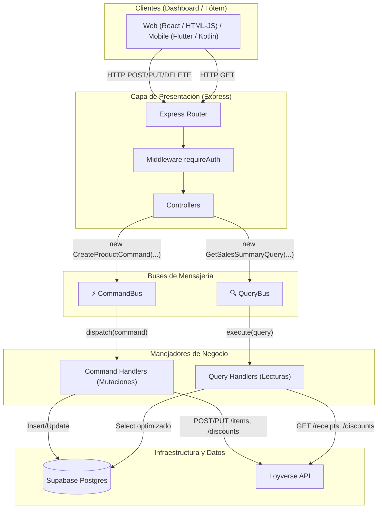

# Arquitectura CQRS Pura (Command Query Responsibility Segregation)

## 1. ¿Qué es CQRS y por qué se implementó en Café Lobo?

**CQRS (Command Query Responsibility Segregation)** es un patrón de diseño arquitectónico que separa de forma estricta las operaciones que **modifican el estado** del sistema (**Commands**) de las operaciones que únicamente **leen información** (**Queries**).

En el proyecto **Café Lobo (Tótem Hackathon)**, esta separación resuelve los desafíos clave:
1. **Diferencia de fuentes de verdad:** Las consultas de catálogo se resuelven en Supabase, las ofertas se resuelven en Loyverse, y el resumen de ventas cruza ambas fuentes en memoria. Con CQRS, cada Query Handler implementa el pipeline de lectura óptimo sin sobrecargar los modelos de escritura.
2. **Tolerancia a fallos asimétrica:** Al crear un producto, una falla en la API de Loyverse no debe romper la creación en Supabase. El `CreateProductCommandHandler` gestiona esta regla de negocio y emite un resultado con estado de sincronización (`loyverse_sync: false`, HTTP 207).
3. **Escalabilidad y mantenibilidad:** Agregar nuevas métricas o vistas para el dashboard o tótem solo requiere crear una nueva Query y su QueryHandler, sin alterar controladores ni rutas existentes.

---

## 2. Diagrama de Flujo CQRS



---

## 3. Componentes del Patrón

### A. Commands (Comandos)
Son objetos DTO inmutables que encapsulan la intención explícita de cambiar el estado del sistema. No retornan datos de dominio para consultas complejas, sino confirmación del cambio y estado de sincronización.
- **Convención:** `VerboSustantivoCommand` (ej. `CreateProductCommand`, `UpdateDiscountCommand`, `DeactivateProductCommand`).

### B. Command Handlers (Manejadores de Comandos)
Contienen la lógica de negocio para validar el comando, orquestar cambios en los modelos de escritura de Supabase y sincronizar con Loyverse:
- Implementan el método `execute(command)`.
- Solo son invocados a través del `CommandBus`.

### C. Queries (Consultas)
Son objetos DTO que representan una solicitud de información. Son puramente idempotentes y carecen de efectos secundarios.
- **Convención:** `GetSustantivoQuery` (ej. `GetProductsQuery`, `GetSalesSummaryQuery`, `GetProductAffinityQuery`).

### D. Query Handlers (Manejadores de Consultas)
Optimizados para velocidad y lectura:
- Pueden leer de Supabase, de la API de Loyverse o realizar agregaciones complejas en memoria (como el Market Basket Analysis en `GetProductAffinityQueryHandler`).
- Implementan el método `execute(query)`.
- Solo son invocados a través del `QueryBus`.

### E. CommandBus y QueryBus
Mediadores en memoria desacoplados:
- **`commandBus.dispatch(command)`**: Localiza el handler por el nombre de la clase del comando, ejecuta middlewares de interceptación y métricas de tiempo, y devuelve el resultado.
- **`queryBus.execute(query)`**: Localiza el query handler, ejecuta middlewares y devuelve el modelo de lectura.

---

## 4. Registro Centralizado (`src/registerBuses.js`)
Al inicializar la aplicación (`app.js`), todos los handlers se registran automáticamente en sus respectivos buses:

```javascript
// Registro de comandos
commandBus.register(CreateProductCommand, new CreateProductCommandHandler());
commandBus.register(CreateDiscountCommand, new CreateDiscountCommandHandler());

// Registro de consultas
queryBus.register(GetProductsQuery, new GetProductsQueryHandler());
queryBus.register(GetSalesSummaryQuery, new GetSalesSummaryQueryHandler());
```
